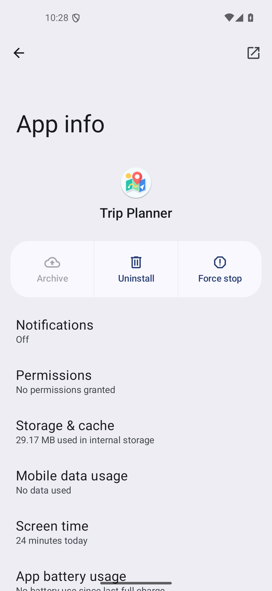
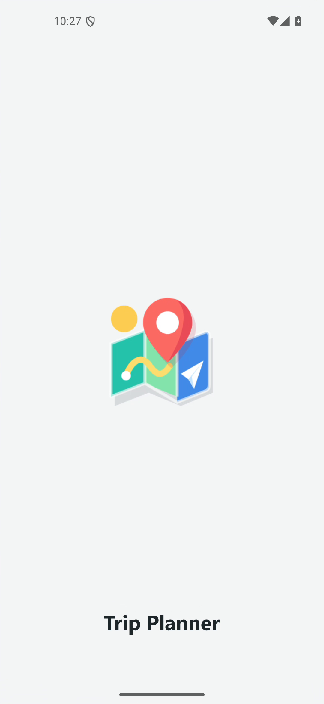
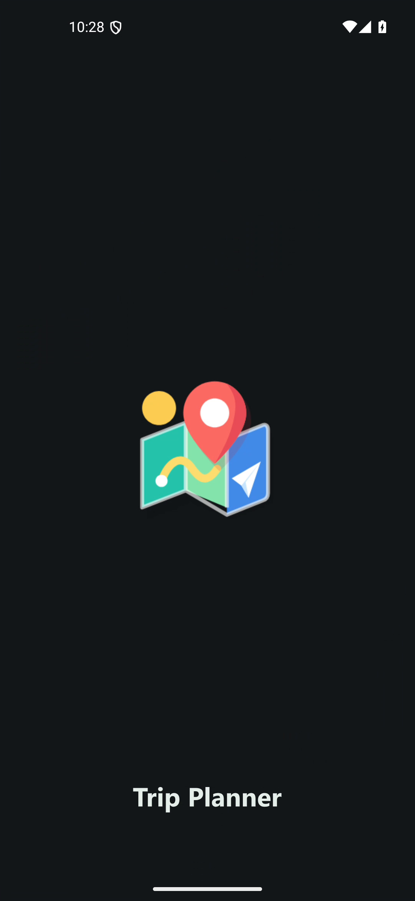

# Trip Planner branding

Version 0.2.1, build 5 introduces a colorful folded-map mark with a coral location pin,
sun-yellow route, mint and blue map panels, and a white paper airplane. Native Android
vector resources remain sharp at launcher and toolbar sizes; a matching monochrome
silhouette supports themed launcher icons.

The native startup splash displays the same mark and the Trip Planner wordmark.
Android 12+ uses the platform splash with persisted application night mode; older
supported versions have light/dark starting-window backgrounds. The splash dismisses
after the initial local trip read, with a short fade that respects disabled animations.
There is no artificial startup delay.

## Verification

- Unit tests: 6 passed, 0 failures.
- Debug lint and assembly: passed; 53 warnings, no errors.
- APK: com.tripplanner.app, version 0.2.1, versionCode 5, arm64-v8a.
- Signing certificate SHA-256 unchanged:
  `6afe635f1eeb6ae2def13bfdd671fee6e1103cb9ca09113d4b1826de433a092d`.
- Android 15/API 35 emulator: installed as an update without clearing app storage;
  both previously saved trips remained visible.
- Light and dark cold-launch recordings verified the native splash, readable wordmark,
  matching home screen, and unclipped icon. No AndroidRuntime errors were reported.
- Theme switching preserved the unsaved new-trip destination without recreating the activity.
- Physical Samsung testing and Android 8-11 splash behavior remain unverified.

## Previews

