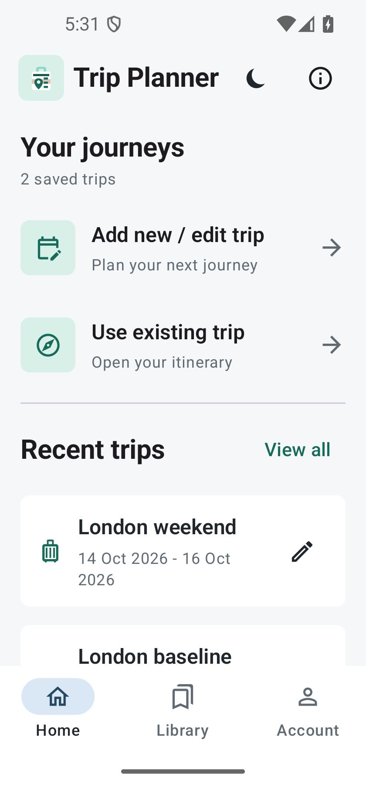
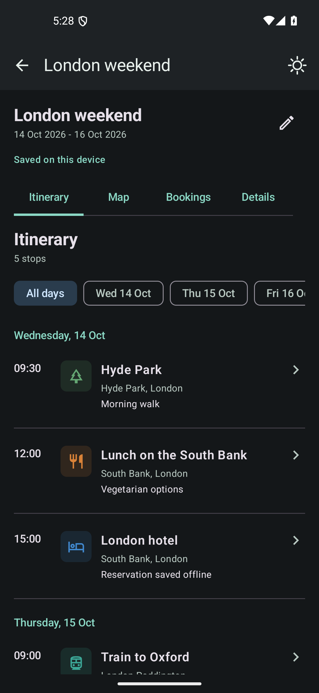

# Trip Planner 0.2.0

## Reference applications

Reviewed the official product pages on 2026-10-13:

- [Wanderlog](https://wanderlog.com/): day itinerary, saved-place lists, maps, and reservations.
- [TripIt](https://www.tripit.com/web/free/trip-planner): accessible itineraries and practical transportation details.
- [Tripsy](https://tripsy.app/): grouped stays, activities, travel details, and notes.

These are interaction references, not copied designs or assets.

## Implemented workflow

- Home keeps the two Plan / Use actions and recent trips visible.
- Library provides General and trip pools, name search, type filters, standalone item creation/editing, order, and related items.
- Account contains Google linking, backup import/export using Android file pickers, and sign out.
- Plan trips provides a New Trip action above searchable active/archive lists, trip import/export, archive, and restore.
- Each trip has Overview, Itinerary, Items, Map, and Bookings sections.
- Itinerary groups scheduled activities by calendar day and keeps unscheduled items accessible.
- The trip date range generates selectors for days without activities, too.
- Items can be reordered by swapping their unique priorities, edited on a separate page, and removed from one trip without deleting their saved General item.
- Item fields are grouped into Details, Contact & links, and Photos & map details. Notes remain editable; related items are collapsed initially.
- Item date/time fields use native calendar and time pickers. Food places and shops can now be scheduled.
- Use mode opens a day itinerary first, with Map, Bookings, and Details views and an individual item detail page.
- Phone, website, and Google Maps actions use installed apps; missing handlers display a recoverable message.
- Dark is the initial skin; the selected light/dark skin persists, with a top moon/sun control.
- Startup uses Android's splash-screen mechanism and the existing custom launcher artwork.

The Room schema, package identity, offline storage, backup format, Google account gate, and API quota controls remain in place. New scheduled fields use existing attribute storage and require no schema change.

Online maps and Places search still require configured credentials. This release does not add live flight data, reservation-email import, collaboration, paid routing, or cloud synchronization.

## Assets and delivery

The empty-trip home image is a bundled London photograph from
[Unsplash](https://images.unsplash.com/photo-1486299267070-83823f5448dd).
It is decorative and never presented as the cover of a user-created destination.

Published APKs retain the original signing certificate. CI verifies and publishes the checked-in signed APK instead of publishing a newly generated runner signing key.

## Verification

- Six unit tests cover legacy/ISO date parsing, invalid date ranges, empty-day selectors, chronological ordering, unique-priority swaps, and removal of dangling relationships.
- Android lint and debug assembly passed.
- Installed build 3, created an account and a saved trip, then upgraded to build 4 with `adb install -r`. Both were retained.
- Emulator checks cover light/dark switching and persistence after a cold launch, a 320 dp layout with increased font size, calendars, archive/restore, JSON trip import, General library creation/search/editing, note persistence, pool linking, reordering, and retaining a General item after removing it from a trip.
- Whole-database export/import through Android's file chooser preserved two test trips, seven General items, and thirteen memberships.
- Cold-launched without network connectivity and opened a saved day itinerary.
- Back navigation returns to Home; Back from Home opens an exit confirmation.
- Package `com.tripplanner.app`, build 4/version 0.2.0, ARM64 ABI, and original APK v2 signing certificate are verified.

These checks use an Android emulator. Physical-phone testing and live Google account/Maps/Places calls are not verified; Maps and Places keys are not configured on this laptop.

