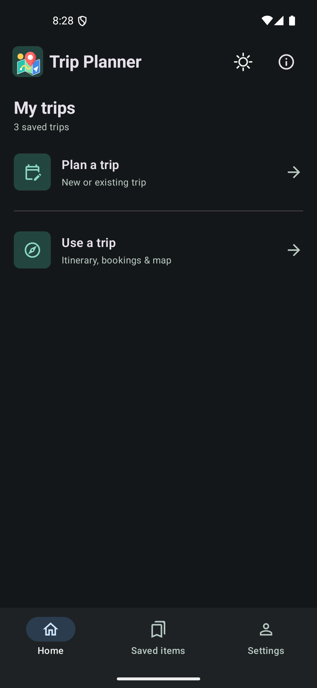
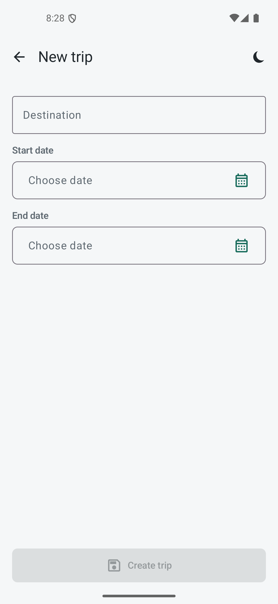
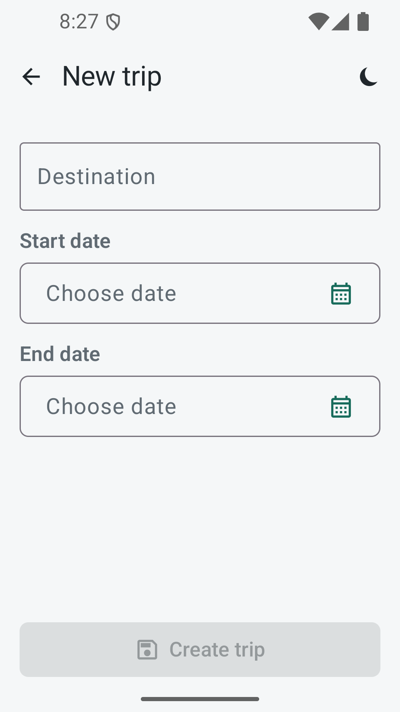
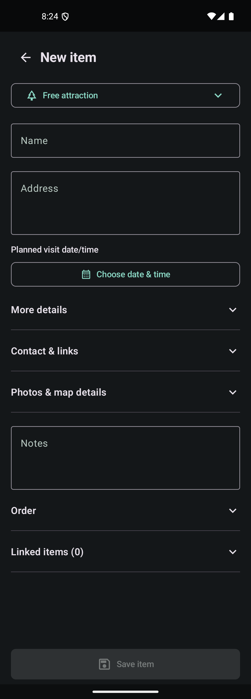

# Simplified UI - v0.2.2, build 6

The home screen has two paths: **Plan a trip** for creation/editing and **Use a trip**
for the saved itinerary. Duplicate recent-trip shortcuts have been removed.
The other destinations are **Saved items** and **Settings**.

New-trip creation contains only the destination and calendar date fields, with a fixed
Create trip action. After creation it opens the item list. Existing trips retain Trip,
Items, Itinerary, and Map tabs; bookings/transportation are expandable in Trip details.

New/edit item forms are separate screens with a fixed Save item action. Saving a trip
item writes to the local database immediately. Essential fields remain visible while
extra details, contacts, map metadata, ordering, and related items can be expanded.
The saved-item editor is full-screen without the home navigation underneath.

Adding saved items opens a separate picker. General and trip pools use a dropdown;
type tags and search remain available. Trip export/archive and item reorder/remove
actions are grouped in labeled overflow menus. Unsaved trip and item edits have discard
confirmations. Backup/restore controls remain in Settings and use Android file pickers.

## Verification

- Nine unit tests passed, including snapshot equality/change detection and date validation.
- Debug assembly and lint passed; 55 warnings, no errors.
- APK: com.tripplanner.app, 0.2.2/build 6, arm64-v8a.
- Original signing certificate retained; emulator update preserved the two prior trips.
- Android 15/API 35 emulator: created a trip with calendar dates, created/saved a hotel,
  reused a person, reordered/saved items, and reopened the persisted itinerary after a cold launch.
- Saved-item creation, pool selection, back/discard/keep-editing confirmations, main-screen
  exit confirmation, theme switching, and the backup destination picker were exercised.
- Normal-size light/dark screens and a 960x1706 compact viewport at 1.3 font scale were
  inspected. The new-trip form and fixed action had no text overlap.
- Native splash cold launch inspected. Google online calls and physical Samsung behavior
  were not revalidated in this UI-only release.

## Previews

